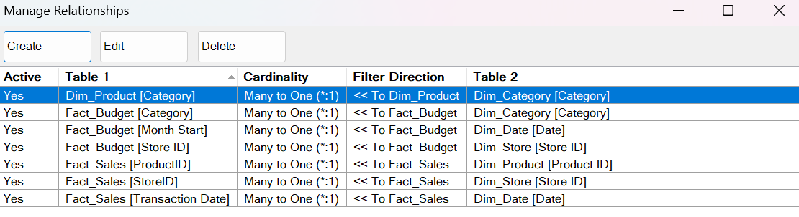

# Data Model

The cleaned tables are loaded into the Excel **Power Pivot** data model as a star schema with two fact tables (sales and budget) that share three dimensions.

## Tables

| Table | Type | Rows | Grain | Source query |
|---|---|---|---|---|
| `Fact_Sales` | Fact | 7,822 | One row per sales transaction | `Sales` (2024 and 2025 appended) |
| `Fact_Budget` | Fact | 2,160 | One row per store, category and month | `Budget targets` |
| `Dim_Store` | Dimension | 15 | One row per store | `Stores` |
| `Dim_Product` | Dimension | 60 | One row per product | `Products` |
| `Dim_Category` | Dimension | 6 | One row per product category | Built from `Products` |
| `Dim_Date` | Dimension | 731 | One row per day, 1 Jan 2024 to 31 Dec 2025 | Built in Power Query |

M code for `Dim_Date` and `Dim_Category`: [`../03_power_query/m_code_dimensions.md`](../03_power_query/m_code_dimensions.md).
The helper query `Sales 2025` is kept as a connection only and is not loaded into the model.

## Relationships

All 7 relationships are **active**, **many-to-one**, with a **single filter direction** from the dimension to the fact table.

| # | Many side (fact) | One side (dimension) |
|---|---|---|
| 1 | `Fact_Sales[Transaction Date]` | `Dim_Date[Date]` |
| 2 | `Fact_Budget[Month Start]` | `Dim_Date[Date]` |
| 3 | `Fact_Sales[StoreID]` | `Dim_Store[Store ID]` |
| 4 | `Fact_Budget[Store ID]` | `Dim_Store[Store ID]` |
| 5 | `Fact_Sales[ProductID]` | `Dim_Product[Product ID]` |
| 6 | `Dim_Product[Category]` | `Dim_Category[Category]` |
| 7 | `Fact_Budget[Category]` | `Dim_Category[Category]` |

## Design decisions

| Decision | Reason |
|---|---|
| **Two fact tables** | Actual sales are recorded per transaction, the budget per store, category and month. They answer different questions and have different grain, so they are kept apart and compared through shared dimensions. |
| **Shared dimensions** (`Dim_Date`, `Dim_Store`, `Dim_Category`) | One slicer (for example Year or Region) filters sales and budget at the same time. This is what makes Actual vs Budget variance possible. |
| **`Dim_Category` as its own table** | The budget has a category directly. Sales only know the category through the product. A single category table links both: `Dim_Category` filters `Dim_Product`, which filters `Fact_Sales`, and `Dim_Category` also filters `Fact_Budget`. |
| **Single filter direction** | Avoids ambiguous filter paths between the two fact tables and keeps DAX results predictable. |
| **`Dim_Date` at day grain** | Sales have a date, the budget has the first day of the month. Month-level slicers filter both correctly. |
| **Table names with `Fact_` / `Dim_`** | Renamed inside Power Pivot. The Power Query names (`Sales`, `Stores`, `Products`, `Budget targets`) are unchanged, so the M code documentation still matches. |
| **Key columns named differently** | `StoreID` and `ProductID` in sales versus `Store ID` and `Product ID` in the dimensions. Power Pivot relates them by choice of column, not by name. |

## Known limitations

- **Product `P999`** (6 sales rows) does not exist in `Dim_Product`. It appears as blank in any category view, and its sales cannot be matched to a budget category.
- **3 sales rows have future dates** (up to 2052). They have `Date Status = "Future date - review"` and fall outside `Dim_Date`. Measures filter on `Date Status = "Valid"`.
- **28 sales rows have no `Total Amount`** and are excluded from sales totals.
- **58 budget cells are null** (36 for Morogoro Road before it opened on 1 July 2024, 22 missing in the source). Variance is blank for those months instead of being calculated against zero.
- **Tanga Mjini (S15)** closed in December 2024 but has a 2025 budget (72 rows).
- The budget source is **draft v3, not final**.

## Checks done

- Row counts match the source queries (7,822, 2,160, 15, 60, 731, 6).
- Every relationship has a unique key on the one side. Power Pivot rejects the relationship otherwise.
- No relationship is inactive and there are no duplicate filter paths between any two tables.
